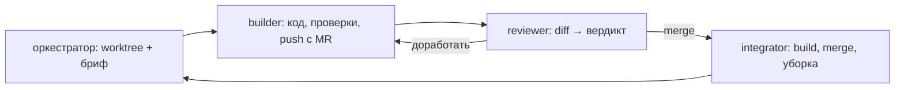

# Система агентов

Оркестратор и семь ролей субагентов Claude Code. Определения — `.claude/agents/*.md`.
Протокол оркестратора — `.claude/skills/orchestrate/SKILL.md` (`/orchestrate`).
Правила проекта агенты получают из `CLAUDE.md`. В промпте роли — только то, чем роль
отличается: что видит, что может, что возвращает.

## Роли

| Роль | Когда | Видит и может | Возвращает |
|---|---|---|---|
| оркестратор (главная сессия) | всё рабочее окно | основная копия на `main`, только чтение; открывает worktree, пишет брифы, запускает агентов | итог окна до 10 строк |
| `builder` | одна задача | свой worktree; контракты и зависимости не меняет | ветка с MR, отчёт до 3 строк |
| `reviewer` | после builder; для контрактов, формата, модели, `.claude/` — всегда | только diff, контракты, README модулей; ничего не правит | вердикт `merge` / `доработать` / `человеку` с `файл:строка` |
| `integrator` | после `merge`, строго по одному | worktree ветки и основная копия; build, merge MR, уборка | merge-commit |
| `qa` | веха, деплой, запрос человека | Playwright на реальном приложении; замеры | сценарий по шагам и замеры — в чат |
| `operator` | веха | приложение в роли руководителя ОПС, проектировщика, инвентаризатора | где сценарий роли не складывается, топ-5 |
| `jury` | веха и сдача | только артефакты репозитория | оценка 0–3 по шести критериям |
| `scribe` | README, документ разошёлся с кодом | worktree; выполняет команды, которые описывает | README, решения, `HANDOFF.md`, список `TBD` |

Модель роли — поле `model:` в её frontmatter. `opus`: `builder`, `reviewer`,
`operator`, `scribe`, `jury`. `sonnet`: `integrator`, `qa`.

Скиллы вне конвейера: `submission-checklist` перед вехой и сдачей, `/explain` — когда
человек просит объяснить ветку, MR, модуль или тему.

## Конвейер задачи

Веха: `qa` → `operator` → `jury` → `submission-checklist` → `scribe`.

## Проверки по ролям

- `builder`: lint, build, `npm test`. e2e — если что-то сломалось или для сохранения,
  загрузки, `src/state/`, демо-планов. UI-правка — проход в браузере, один снимок в
  scratchpad, клавиатура.
- `integrator`: только `npm run build` после merge `origin/main`.
- `qa`: весь e2e — перед вехой.
- Отчёты ролей идут в чат. md-файлы с отчётами в git не попадают (`CLAUDE.md`,
  «Документы»).

## Запуск вручную

- Субагент стартует в рабочем каталоге главной сессии. Поэтому worktree открывает
  оркестратор, а путь идёт в бриф.
- `check-secrets.sh` видит только текущую копию. Хук `SubagentStop`
  (`check-worktrees.sh`) проверяет все worktree после каждого субагента.
- `reviewer`, `jury`, `operator` файлы не правят. Временные spec
  `tests/e2e/_operator-*.spec.ts` удаляются после прогона.
- e2e из worktree запускай со своим портом: `DEV_PORT=5174` (D-095, D-096).
- Codex и другие агенты получают протокол из `AGENTS.md`.

## Ограничения

- Оркестратор не чинит `main` сам. Починка — задача для builder с высшим приоритетом.
- Агенты не ходят к организаторам.
- Агент берёт задачу только от имени человека своей сессии (D-298, D-299).
- Новую зависимость или сокращение объёма условий агенты выносят человеку. Правку
  контракта и `.claude/` агент проверяет и вливает сам.
