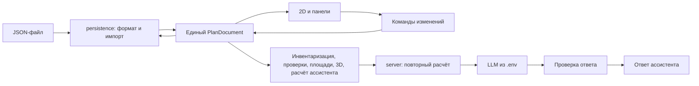

# Архитектура цифрового двойника ОПС

Действующие правила устройства. Каталоги и владельцы — [project-structure.md](project-structure.md),
типы — `src/contracts/`, решения — [decisions.md](decisions.md). Прежняя версия этого
файла (предложение от 16.09) — в истории git.

## Поток данных

- Все потребители читают один снимок `PlanDocument`. Инвентаризация, площади,
  проверки, 3D и рекомендации — производные данные. Копий плана они не держат.
- Сохранение сериализует документ, а не дерево Konva/Three.js и не состояние панелей.
- `src/domain/` не импортирует React, DOM, store и серверный код. Модули соединяет
  только `src/app/`.
- Нет платформы плагинов, шины событий, DI-контейнера и универсального движка правил.

## Модель и геометрия

- Метры, X вправо, Y вверх, положительный угол — по часовой стрелке (D-010).
  `position` — центр, `size_m` — размер до поворота. Отражение Y — только в
  `src/domain/geometry`.
- Помещение и зоны — простые полигоны без отверстий. Зона знает родителя
  (`parentId`). Слой — сущность отображения (`visible`, `locked`, `order`), не тип зоны.
- Объект хранит один `zoneId`: самую глубокую зону, которая содержит весь след
  объекта. Нет такой зоны — `null` и сообщение. Перемещение пересчитывает связь.
- Физический объект и занятая площадь пола — разные свойства. Камера на стене пол не
  занимает.
- Свободная площадь = площадь помещения − объединение следов напольных объектов.
  Вложенные зоны не суммируются. Это площадь пола, не проверка проходов.
- Размеры и правила справочника без источника помечены как синтетические допущения.

## Редактирование и сохранение

- Жест перемещения показывает preview. Отпускание мыши даёт одну команду и одну
  запись undo.
- Асинхронный результат привязан к `revision`. После правки он помечен устаревшим.
- Структурно нечитаемый JSON не заменяет открытый план. Геометрически ошибочный план
  открывается с находками проверки: пользователь его исправляет.
- Импорт чужой файл молча не исправляет.
- Неизвестная будущая версия формата отвергается без потери открытого документа.

## Ассистент и сервер

- Числа, кандидаты и эффект считает код. LLM выбирает сценарий и объясняет.
  Модель не двигает объекты и не выполняет код.
- Сервер повторяет расчёт по присланному плану и передаёт модели только факты.
  Ответ проверяется: `id` существуют, числа совпадают с расчётом.
- Нет ключа, timeout, 429, неверный JSON или неверные факты — показываем расчёт с
  пометкой «без LLM».
- Провайдер, адрес и модель — только из серверного `.env` (`LLM_PROVIDER`,
  `LLM_ENDPOINT`, `LLM_MODEL`, `LLM_API_KEY`). Браузер адрес не задаёт. Ключи и планы
  в логи не пишем.
- «Не найдено» значит «не найдено перебором», а не «места нет». Правило терминала
  ≤ 3 м от входа — правило команды, не норматив.

## 3D и производительность

- 3D строится из документа и справочника. Своей копии геометрии нет. Нет WebGL —
  сообщение, 2D и сохранение работают.
- Замер — `tests/perf/`, результат и команда — README, «Проверенный объём данных».
- Оптимизация — только после замера.
