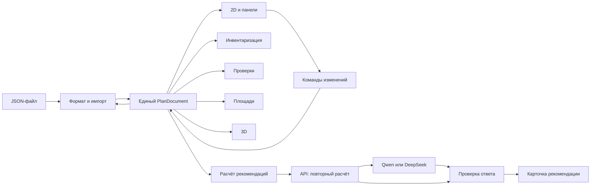

# Архитектура цифрового двойника ОПС

Дата: 16.09.2026. Статус: **предложение для команды, реализация не начата**.
Команда — пять опытных разработчиков с coding agents; цель — сильный конкурсный
продукт с точным UX, проверяемыми рекомендациями и измеренной отзывчивостью.
Это стартовый проект архитектуры; слияние документа не означает, что библиотеки
уже установлены или производительность измерена. Рабочие правила — [CLAUDE.md](../CLAUDE.md).

Навигация: [каталоги и владельцы](project-structure.md), [контракты v1](contracts-v1.md), план независимых работ,
[независимый Deep Research](research/deep-research-brief.md).

## 1. Что существует и что требуется

Изучены `task.md`, `example_plan.json`, `Перечень_оборудования_ОПС.pdf`, `CLAUDE.md`,
`GIT.md`, `HANDOFF.md`, журнал решений и матрица требований. На момент анализа
`origin/main` = `f53026b`: только шаблонный README. Правила и материалы — в
`worktree-infra-rules`, commit `c79b081`, MR !1. Эта ветка документации создана от
`origin/main`, затем fast-forward до `c79b081`; перед её merge следует влить MR !1.
После этого MR !1 и !2 влиты в main (`c1d7da1`); создана физическая
[структура каталогов](project-structure.md). Кода приложения, схемы, зависимостей,
тестов продукта и деплоя ещё нет.
HTML-ориентир отсутствует и не анализировался; его получение не блокирует архитектуру.

Ценность: редактируемый синтетический план → связанная инвентаризация → проверка →
объяснимая рекомендация → ручная правка → сохранение → повторное открытие.
Вес редактора, модели и корректного хранения вместе — 65%; 3D — 5%.
Деплой и ZIP нужны к вечеру 21.09; сдача 22.09. Точное время и хостинг — вопросы
организаторам из `HANDOFF.md`, не технические допущения.

## 2. Выбор формы приложения

| Вариант | Преимущество | Цена и риск | Вывод |
|---|---|---|---|
| React SPA + небольшой Node backend, общие чистые TypeScript-модули | Одна модель и геометрия в браузере и на сервере, независимые UI-модули | Нужно дисциплинированно отделить серверные секреты | Рекомендуется для шестидневного срока |
| React SPA + Python backend для всей геометрии | Удобен команде с сильным Python/GIS опытом | Два представления контрактов, запросы при редактировании либо дублирование расчёта | Выбрать только при явном преимуществе опыта команды |
| Несколько сервисов, БД, отдельные редактор/инвентаризация/AI | Изоляция развёртывания | Миграции, сеть, согласование состояния, лишний критический путь | Отложить за пределы хакатона |

Предложение по стеку: TypeScript, React, Vite; Konva/react-konva для холста;
небольшой store на Zustand; Zod для входных данных; polygon-clipping для булевых
операций; Three.js для условного 3D; Node + Fastify для API; Vitest и Playwright.
Один репозиторий, один `package.json`, один lockfile, один контейнер: Node отдаёт
сборку SPA и `/api/*`. БД для файлового MVP не нужна: основной переносимый артефакт —
JSON-файл, который скачивают и снова открывают. Браузерный черновик — отдельное удобство.
Совместное редактирование одного плана несколькими пользователями не требуется:
параллельность команды разработки обеспечивается контрактами и Git.

Это ещё не утверждённый стек. В задаче F01 команда фиксирует совместимые точные версии,
Node runtime, лицензионные условия и команды в `CLAUDE.md`, выполняет чистый запуск.
Предлагаемые команды после F01: `npm ci`, `npm run dev`, `npm test`,
`npm run typecheck`, `npm run lint`, `npm run build`, `npm run test:e2e`.
Сейчас этих команд у проекта нет.

Проверенные первичные источники (16.09.2026): [Vite](https://vite.dev/guide/),
[React Konva](https://konvajs.org/docs/react/index.html),
[Transformer](https://konvajs.org/docs/react/Transformer.html),
[polygon-clipping](https://github.com/mfogel/polygon-clipping).
Konva предоставляет React-примитивы сцены; её Transformer изменяет scale узла,
поэтому в конце жеста размер нужно нормализовать в метры и сбросить scale.
polygon-clipping предоставляет union/intersection/difference; численная устойчивость
на наших случаях проверяется тестами. Выбор этих библиотек — инженерное предложение,
а не результат сравнительного бенчмарка. Остальные кандидаты требуют проверки в F01.

## 3. Модули и поток данных

Все потребители читают один снимок `PlanDocument`. Инвентаризация, площади, проверки,
3D и рекомендации — производные данные; они не редактируют копии плана.
Сохранение сериализует документ, а не дерево Konva/Three.js и не состояние панелей.
Чистые модули из `src/domain/` не импортируют React, DOM, store или серверный код.
UI общается через props и команды; только `src/app/` соединяет модули.

| Модуль | Собственная ответственность | Малый внешний интерфейс |
|---|---|---|
| contracts | Типы, схемы, примеры контрактов | `PlanDocument`, `Command`, `Issue`, `Recommendation` |
| geometry | Полигоны, поворот, пересечения, преобразования | footprint, intersects, contains, modelToScreen |
| relations | Иерархия зон и назначение объекта зоне | resolveZone, reconcileZones |
| metrics | Объединение площадей и занятость | measurePlan |
| catalog | Типы и правила в JSON, проверка каталога | validateCatalog |
| state | Атомарные изменения, revision, undo | applyCommand, dispatch |
| persistence | Версия файла, decode/encode, черновик | decodePlan, encodePlan |
| validation | Список нарушений с объектами и геометрией | validatePlan |
| inventory | Перечень и группировки | buildInventory |
| assistant | Поиск, комплектование, эффект, проверка объяснения | calculateAdvice, verifyExplanation |
| editor/panels | Холст, инструменты, карточки | props с документом и callback команд |
| view3d | Производная сцена и её показ | buildScene, View3D |
| server | Конфигурация, лимиты, внешний API | POST /api/advice, GET /api/health |

Здесь модуль скрывает сложность за небольшим интерфейсом. Не вводим абстрактную
платформу плагинов, шину событий, DI-контейнер или универсальный движок правил.
Два реальных внешних LLM-провайдера обслуживает простой адаптер с конфигурацией.

## 4. Модель и геометрия

Полные поля и контракты — [contracts-v1.md](contracts-v1.md).
Предлагается собственный версионированный JSON со снимком справочников внутри файла.
Это позволяет открыть пользовательский тип на другой машине без потери атрибутов.
`example_plan.json` импортируется отдельным адаптером и остаётся неизменным тестовым
источником с намеренно обнаруживаемыми ошибками. Это не наш итоговый демо-проект.

- Метры, X вправо, Y вверх; положительный угол — по часовой стрелке, центр объекта
  в `position`, локальные размеры в `size_m`. Отражение Y выполняется только в geometry.
- Помещение — один простой полигон без отверстий; зоны — такие же полигоны с
  `parentId`. Родители содержат детей; соседи не перекрываются площадью. Слои —
  отдельная сущность отображения с `visible`, `locked`, `order`, а не тип зоны.
- Объект хранит единственный `zoneId`; выбирается самая глубокая зона, содержащая
  весь footprint. При неоднозначности/отсутствии — `null` и диагностическое сообщение.
  После перемещения объекта или изменения зон связь пересчитывается атомарно.
- Физический объект и занимаемая площадь пола — разные свойства. Камера на стене
  физическая, но не занимает пол; принтер на столе не конфликтует со столом только
  из-за совпадения проекции: учитываются вертикальные интервалы.
- Высоты и размеры справочника, не взятые из материалов, явно помечаются как
  синтетические допущения. Не выдаём геометрическую проверку за строительную экспертизу.
- Свободная площадь = площадь помещения минус площадь объединения отпечатков
  объектов, занимающих пол, обрезанного границей помещения. Вложенные зоны не суммируются.
  Это площадь проекции свободного пола, не доказательство доступности проходов.
- Перегородки задаются отрезками с толщиной; проёмы принадлежат стене. Для импорта
  примера толщина, которой там нет, задаётся как явное допущение адаптера.

Схема синтетического отделения для первого ручного демо: помещение 10 × 8 м,
клиентская зона `[0,0]–[7,8]`, служебная `[7,0]–[10,8]`, вложенная зона ожидания
`[0.5,5]–[4,7.5]`; вход на верхней границе, два окна, две скамьи, стеллаж в служебной
зоне. Точные размещения выбираются и проверяются в редакторе; эта схема не готовый
файл сдачи. Для первого сквозного среза достаточно помещения, одной зоны и одного объекта.

## 5. Редактирование, ошибки и сохранение

Store хранит `document`, `revision`, `selection`, `dirty` и ограниченную историю команд.
Жест перемещения имеет локальный preview; mouse-up даёт одну команду и одну запись undo.
Крупные проверки и поиск места выполняются по завершённому изменению, не на каждый пиксель.
Асинхронный результат привязан к revision и не показывается как актуальный после правки.

Структурно нечитаемый JSON не заменяет текущий план. Геометрически ошибочный, но
структурно корректный план открывается с диагностикой: пользователь должен иметь
возможность исправить исходный пример. Изменения могут создавать исправимые нарушения
геометрии, но не сломанные ссылки, дубли ID или нечисловые координаты.
Импорт не исправляет чужой файл молча; явное пересчитывание связей — команда редактора.

`Файл → Скачать JSON` работает независимо от LLM/сервера. У скачивания нельзя достоверно
подтвердить запись на диск: UI сообщает «файл подготовлен к скачиванию». При наличии
ошибок геометрии сохраняем документ вместе с видимым предупреждением; плохая структура
блокирует экспорт. Перед заменой dirty-документа требуется решение пользователя внутри
приложения. Черновик сохраняется отдельно; quota/corruption не стирают память редактора.
Схема неизвестной будущей версии отвергается без потери открытого документа.

## 6. Рекомендации и сервер

Три режима: найти место; проверить комплектование; сравнить текущий план с выбранным
снимком «до». Ввод свободным текстом может предложить режим, но явный выбор режима
работает без модели. Модель не перемещает объекты и не выполняет код.

Код выдаёт кандидаты, ссылки на существующие ID, правила, допущения и метрики.
Поиск места перебирает сетку 0.1 м и углы 0/90° с ограничением числа кандидатов.
Отсутствие результата означает «на этой сетке не найдено», не «места не существует».
Каждый кандидат повторно проходит геометрию; кратчайшие пути, эвакуация, эргономика
и нормативы не подразумеваются. Примерное правило терминала ≤3 м от входа проверяется
как расстояние до середины указанного входа и подписывается источником и ограничением.

Сервер повторяет детерминированный расчёт по присланному плану, затем передаёт модели
только необходимые факты и текст запроса. Проверяет схему, ссылки и значения чисел.
Для строгой проверяемости v1 модель выбирает `reasonCode`, `factIds`, `candidateId`,
а видимый текст и числа собираются из разрешённых русских шаблонов. Произвольный текст
модели не публикуется без семантической проверки: совпадения чисел недостаточно, чтобы
обнаружить фразу «уменьшилось» вместо «увеличилось». Этот компромисс явно описываем.

Нет ключа, timeout, 429, неверный JSON или неверные факты → результат расчёта с
пометкой «без LLM». Ответ старой revision помечается устаревшим. Смена провайдера —
`LLM_PROVIDER`, `LLM_BASE_URL`, `LLM_MODEL`, `LLM_API_KEY`, только на сервере.
Конкретные endpoint/model ID и доступ из РФ проверяет владелец API, не берём из памяти.
Базовый URL приходит только из серверной конфигурации; браузер не может задать URL.
Лимит тела запроса, времени, длины текста, частоты и числа одновременных вызовов;
ключи и полные пользовательские планы не пишем в логи. Платные тесты отделены от CI.

## 7. 3D и производительность

3D получает документ и справочник; `(x,y,z)` модели отображается в `(x,z,-y)` Three.js.
Высота — из модели/справочника, зоны — плоскости пола; внутреннее состояние камеры
допустимо, собственная копия геометрии плана — нет. Нет WebGL → понятное сообщение,
2D и сохранение продолжают работать. Загрузка 3D по требованию.

Предварительные наборы замера: 100/500/1000 объектов и 10/30/50 зон, фиксированный seed.
Записываем браузер, машину, commit, время открытия, p50/p95 отклика перетаскивания,
длительность проверки и ошибки. Цель для 500 объектов: p95 отклика <100 мс,
открытие <2 с на указанной машине; это цель, не заявленная способность.
Оптимизация после замера: bbox-фильтр перед пересечениями, разделение отрисовки и
панелей, затем при необходимости worker. Worker и spatial index заранее не требуются.

## 8. Как команда работает независимо

Одни и те же данные не означают общие файлы реализации. Каждый пакет имеет владельца
путей, контракт, тесты и отдельный MR. Сначала F01/F02: каркас и контракты с fixtures.
После этого UI, каталоги, импорт, геометрия, API, 3D и тестовая инфраструктура
разрабатываются параллельно. Начать на заглушке можно раньше готового поставщика,
но принять интеграцию можно только на его реальной реализации.

`package.json`, lockfile, `src/app/`, общие типы и общие документы имеют по одному
владельцу. Изменения общих документов каждый участник готовит в своём MR; интегратор
последовательно объединяет строки без переписывания истории. Изменение контракта —
сначала согласование затронутых потребителей, затем обновление fixtures и один MR.
Внутренние функции соседнего модуля не импортировать. Подробный DAG и карточки работ —
в плане; независимость не означает отсутствие конечной интеграции.

## 9. Критерии принятия архитектуры

1. F02 фиксирует спорные оси, зоны, высоты, структуру файла и ошибки контрактными тестами.
2. Первый сквозной сценарий заканчивается повторным открытием изменённого JSON.
3. Пример организаторов даёт ожидаемые диагностики; пользовательские типы переживают round-trip.
4. Все пункты матрицы требований имеют владельца в плане; ни один пока не помечается готовым.
5. Три сценария ассистента работают с расчётом, при ошибке API и с проверенным API.
6. Финальный демо-план создан командой в редакторе; оба варианта из ZIP открыты заново.
7. После ответа Deep Research пересматриваются только решения, для которых представлены
   проверяемое противоречие или заметное сокращение риска/работы.
