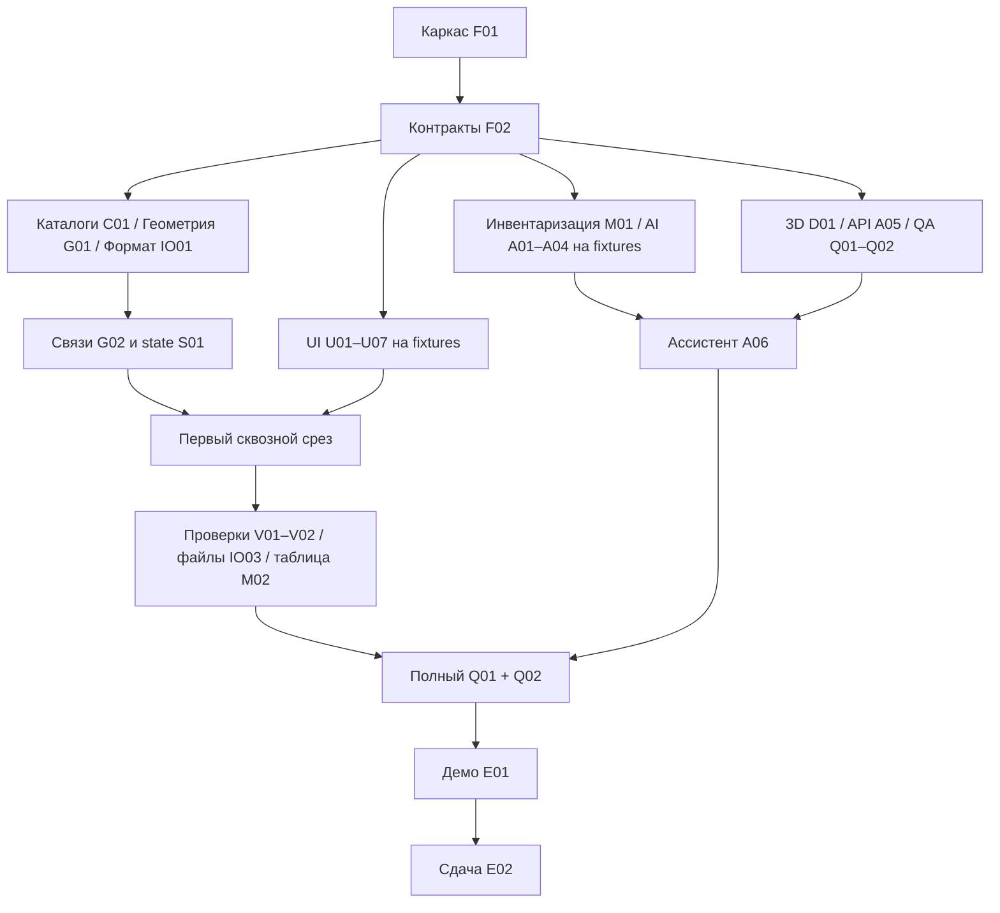

# План независимых работ: цифровой двойник ОПС

> **For agentic workers:** REQUIRED SUB-SKILL: Use executing-plans to implement this plan task-by-task; subagent-driven-development — только при явно выбранном командой делегировании. Steps use checkbox (`- [ ]`) syntax for tracking.

**Goal:** К вечеру 21.09.2026 получить развёрнутый редактор и ZIP, пройти сдачу 22.09.

**Architecture:** Один документ, чистые расчёты, независимые UI-модули через props/команды,
небольшой сервер только для внешнего LLM и раздачи SPA. Общие контракты фиксируются первым срезом.

**Tech Stack:** Предложение TypeScript/React/Vite/Konva/Zustand/Zod/Three.js,
Node/Fastify, Vitest/Playwright; F01 фиксирует версии и команды.

**Spec:** [Архитектура](../architecture.md), [контракты v1](../contracts-v1.md).

## Global Constraints

- Только синтетические данные. LLM — только Qwen или DeepSeek по API; ключи только на сервере в env.
- Числа считает код; ответ модели проверяется; сбой API даёт объяснение «без LLM».
- Метры, position — центр, X вправо, Y вверх, положительный поворот по часовой стрелке.
- Один PlanDocument; данные каталога внутри сохраняемого файла; инвентаризация и 3D производные.
- UI/документация на русском; идентификаторы/комментарии кода на английском.
- Все изменения в личном worktree, только свои файлы, commit/push/MR по GIT.md, без force и прямого push main.
- Запуск проверок перед утверждением о готовности; заявленные npm scripts пока проектируются, сейчас их нет.
- Не делаем распознавание планов, видеоаналитику, 1С, фотореализм, автоматическую перестановку, real-time collaboration.

## Как читать и брать работу

34 пакета — максимальное практическое разделение по самостоятельному результату.
Это не 34 человека и не 34 одновременно готовых к интеграции задач. Работа пакета
начинается после зависимостей столбца «Старт»; на fixtures можно заменить ещё не
готовые зависимости из «Приёмка». Приёмка обязательно использует реальные модули.
Каждый пакет имеет одного владельца; имя назначается в HANDOFF, роли ниже — предложения.
Оценки сроков — план команды, не измеренная производительность людей.

Сейчас создаются только документы. F01/F02 — первые задачи реализации после согласования
предложения. Исследование R01 и уточнение хостинга/ключей можно начать немедленно.

| ID | Пакет | Роль | Старт | Приёмка после |
|---|---|---|---|---|
| F01 | Каркас, версии и команды | интегратор | — | — |
| F02 | Заморозка контрактов и fixtures | владелец модели | F01 | F01 |
| C01 | Справочники зон, оборудования и правил | каталоги | F02 | F02 |
| G01 | Базовая геометрия и координаты | геометрия | F02 | F02 |
| G02 | Иерархия зон и назначение объектов | связи зон | F02 | G01 |
| G03 | Площади и свободный пол | метрики | F02 | G01 |
| S01 | Команды и единое состояние | состояние | F02 | G02, C01 |
| IO01 | Версионированный JSON и round-trip | формат | F02 | F02 |
| IO02 | Адаптер примера организаторов | импорт | F02 | C01, IO01 |
| IO03 | Открытие, скачивание и черновик | файловый UI | F02 | IO01, S01 |
| U01 | Композиция приложения и дизайн основы | интегратор UI | F02 | S01 |
| U02 | Холст, масштаб, сетка и выбор | холст | F02 | G01 |
| U03 | Помещение, зоны, перегородки и проёмы | инструменты плана | F02 | S01, U02 |
| U04 | Оборудование: фигуры и жесты | объекты 2D | F02 | S01, U02 |
| U05 | Панель слоёв | слои | F02 | S01 |
| U06 | Карточка свойств и расширяемые атрибуты | свойства | F02 | S01, C01 |
| U07 | Библиотека оборудования | библиотека UI | F02 | S01, C01 |
| M01 | Расчёт инвентаризации | инвентаризация | F02 | F02 |
| M02 | Таблица инвентаризации и метрики | инвентаризация UI | F02 | M01, G03, S01 |
| V01 | Диагностика корректности | проверки | F02 | G01, G02, IO02, C01 |
| V02 | Список ошибок и подсветка | проверки UI | F02 | V01, U02 |
| A01 | Детерминированный поиск места | поиск места | F02 | G01, G02, G03, C01 |
| A02 | Недостающее и лишнее оборудование | комплектование | F02 | M01, C01 |
| A03 | Эффект изменения и сборка рекомендаций | эффект | F02 | A01, A02, G03, M01 |
| A04 | Проверка ответа LLM и объяснения | проверка LLM | F02 | F02 |
| A05 | Серверный API и Qwen/DeepSeek | API | F02 | A03, A04 |
| A06 | Панель ассистента | ассистент UI | F02 | A03, A04, A05, S01 |
| D01 | Производный 3D-вид | 3D | F02 | G01, C01 |
| I01 | CI и воспроизводимый деплой | инфраструктура | F01 | A05 |
| Q01 | Сквозной сценарий и регрессия | QA | F02 | IO03, U01, U03, U04, U05, U06, U07, M02, V02, A06, D01 |
| Q02 | Замер масштабируемости | производительность | F02 | U01, U02, U04, V01 |
| E01 | Собственный демо-проект и ZIP | демо | F02 | Q01, A06 |
| E02 | README, доказательства и сдача | документация/координатор | F02 | I01, Q01, Q02, E01, D01 |
| R01 | Независимое исследование | исследователь | — | — |

### Два уровня приёмки UI

IO03, U02–U07, M02, V02, A06 и D01 принимаются локально в браузерном стенде
`tests/harness/<ID>.tsx`, который создаёт владелец пакета. F01 публикует инфраструктуру
стенда, F02 — интерфейсы Tool/WorldPointer/FocusRequest/EditorSession и callbacks.
E2E-команды карточек до app-интеграции запускают этот стенд; Q01 проверяет реальное
приложение. Стенд не попадает в production build.

Подключение каждого UI-пакета — явная подзадача U01 с зависимостью от его принятого MR:
U01a каркас на fixtures → U01b холст+инструменты+файлы → U01c таблица+проверки →
U01d ассистент+3D. U01 в таблице обозначает U01a; Q01 финально требует U01a–d.
Человек 2 заранее резервирует два окна интеграции в день, человек 5 проверяет результат.
Это устраняет скрытое ожидание app при локальной приёмке, но не отменяет интеграцию.

## Граф и критический путь

Критический путь первого среза: F01 → F02 → G01 → G02 → S01 →
U01+U02+U03+U04+U07+IO03 (IO01 параллельно) → первый round-trip Q01.
Q01 принимается окончательно после всех зависимостей таблицы, но его первый сценарий
выполняется уже на срезе. Ранний деплой I01 может работать с health/SPA-заглушкой сервера,
финальная приёмка — с A05. A04 и серверный транспорт не ждут алгоритмов: используют
advice fixture, затем проходят интеграцию с A03. R01 не блокирует старт контрактов.

## Пять разработчиков с агентами: высокая конкурсная планка

Подтверждено пользователем: **5 опытных участников, большой опыт хакатонов, каждый
пишет код с помощью Codex/Claude**. Имена назначает команда; ниже пять постоянных
владельцев направлений. Пакеты остаются единицами работы людей и их агентов.

| Человек | Основной поток и пакеты | Ответственность на стыках |
|---|---|---|
| 1 — модель | F02, G01, G02, G03, S01, V01 | Контракты, геометрия и инварианты; ревью формата и расчётов AI |
| 2 — редактор | U01, U02, U03, U04, U05, U06, U07 | UX, app-композиция, жесты, undo; единственный владелец подключения панелей |
| 3 — данные и представления | C01, IO01, IO02, IO03, M01, M02, V02, D01 | Полнота каталога, сохранение, связанная таблица и 3D; ревью round-trip |
| 4 — ассистент | A01, A02, A03, A04, A05, A06 | Детерминированные кандидаты, проверяемые объяснения, live API и fallback |
| 5 — интеграция и качество | F01, I01, Q01, Q02, E01, E02; организация R01 | Версии/CI/деплой, ранние E2E, независимые проверки, демо и комплект сдачи |

Человек 5 начинает деплой и тестовый каркас в первый день, не ждёт конца разработки.
Человек 2 владеет композицией UI, человек 5 — последовательностью merge и релизом;
это разные файлы и обязанности. R01 запускается отдельной исследовательской сессией.
У каждого владельца есть слот на ревью и интеграцию: планировать 20–25% дня, а не
заполнять все часы генерацией кода. Это организационный резерв, не оценка скорости команды.

Агенты одного владельца могут брать разные пакеты на fixtures. Один агент пишет,
другой проверяет контракт и граничные случаи; не поручать им одновременно один файл.
Ускорение генерации кода не отменяет порядок merge контрактов и фактические браузерные
проверки. Дважды в день команда синхронизирует контракты и проходит сквозной сценарий.

### Планка качества, которую видно на демонстрации

Это критерии приёмки существующих пакетов, а не необязательная полировка:

| Качество | Владелец / пакеты | Наблюдаемое доказательство |
|---|---|---|
| Точный редактор | 2: U02–U06; 1: S01 | Привязка к сетке с отключением, числовые координаты/размеры/угол, zoom-to-cursor, многократные undo/redo без потерь, cancel жеста через Escape, понятные hotkeys |
| Цельная работа с планом | 2+3: U01/M02/V02/IO03 | Один выбор синхронизирует холст, свойства и таблицу; ошибка приближает участок; несохранённые правки защищены; исправление сразу видно |
| Убедительная рекомендация | 4: A01/A03/A06 | До трёх допустимых вариантов размещения с прозрачным ранжированием, footprint-preview без мутации плана, реальные факты/допущения, before/after после ручной правки |
| Соответствующий 3D | 3: D01 | Выделенный объект и его поворот/размер/высота совпадают с 2D; выбранный Ref подсвечен, переход между видами не теряет правки |
| Доказанная отзывчивость | 5: Q02 | Замер 100/500/1000 объектов, цель p95 <100 мс на 500, публикация реальных данных и устранение заметных лагов |
| Демонстрация без обходов | 5: Q01/E01/E02 | Пять минут: создать/загрузить → изменить → найти и исправить ошибку → рекомендация → эффект → 3D → сохранить и открыть скачанный файл |

Правила ранжирования A01: сначала минимальное число нарушений (допустимы только 0),
затем расстояние до выбранной пользователем опорной точки или центра целевой зоны,
затем стабильный порядок x/y/угла. Это понятная эвристика, не утверждение оптимальности
или соответствия эргономическим нормативам. Одинаковые footprints дедуплицируются.
Контрактный preview получает Candidate через app; U04 рисует полупрозрачный слой,
не коммитит object.put. После ручного изменения A03 показывает достигнутый эффект.

## Общие файлы и протокол интеграции

- F01 владеет manifest/lock/config; другие участники передают список зависимостей ему.
  Перед стартом Q02/E01 добавляет `test:perf` и `package:demo`, когда их scripts существуют.
- F02 владеет `src/contracts/*`. После freeze исправление публикуется с перечнем
  потребителей; несовместимое изменение не проталкивается в одиночку.
- U01 единолично меняет `src/app/*` и глобальный CSS. Остальные UI-модули имеют локальные стили.
- Общие `HANDOFF.md`, `docs/decisions.md`, `docs/tz-compliance.md` обновляются в каждом MR
  по правилам проекта; интегратор согласует добавляемые строки перед merge. Это явная
  точка координации, а не обещание отсутствия конфликтов в этих трёх файлах.
- Контрактные fixtures общие и неизменяемые потребителями; тестовые данные конкретного
  пакета лежат рядом с его тестом. Никаких общих barrel-файлов, которые правит вся команда.
- В MR указать ID пакета, контракт, зависимости MR, выполненную команду/вывод и ограничения.
  Последовательность: fetch → merge origin/main при необходимости → проверки → хуки →
  git add явных путей → commit → fetch/status → push с merge_request.create/target=main.
  Merge выполняется участником в GitLab; каждый контрактный MR ревьюит второй участник.

## Календарь и границы сокращения объёма

| Когда | Проверяемая веха | Если отстаём |
|---|---|---|
| 16.09 | Назначены владельцы, выбран стек, F01/F02; первый CI и минимальная страница | Не тратить день на сравнение фреймворков; R01 возвращает риски отдельно |
| 17.09 | Первый сквозной сценарий: создать → зона → объект → сохранить → открыть | Приоритет всем задачам критического пути; сначала закрыть точные базовые жесты, затем расширить полигоны без смены формата |
| 18.09 | Полная библиотека, слои, свойства, inventory, диагностика; доступен ранний деплой | Отложить украшения, а не CRUD зон/слоёв и сохранение |
| 19.09 | Три расчётных сценария, API smoke, fallback, базовый 3D | Перебор сетки вместо оптимизатора; условные боксы вместо моделей |
| 20.09 | Ручной собственный демо, полный Q01, Q02, README на чистой машине | Исправлять наблюдаемые дефекты и ограничения; не расширять функции |
| 21.09 вечер | Деплой + ZIP + факты для PDF, jury и checklist | Заморозить формат; обязательные пункты не вычёркивать ради полировки |
| 22.09 | Проверить ссылки/доступ/ZIP/PDF и отправить | Не начинать новые функции; время сдачи уточнить заранее |

Сокращаем первыми: декоративные иконки, произвольные сложные профили стен, продвинутые
горячие клавиши, экспорт картинок, оптимальное размещение, серверное хранение проектов.
Все обязательные категории/слои/атрибуты/три сценария/3D сохраняются. Если минимальный
обязательный объём не укладывается, явно сообщить координатору о незакрытых пунктах.

## Карточки пакетов

Для каждой карточки цикл: тест поведения → увидеть ожидаемый провал → реализация →
зелёный тест → интеграционный сценарий → docs/commit/push. Тесты используют публичный
контракт. Для R01 и E02 вместо теста кода — проверка источников/артефактов.
Пути ниже — создаваемые файлы, кроме существующих CLAUDE.md и README.md.

### F01 — Каркас, версии и команды

**Владелец:** интегратор. **Старт:** —. **Для приёмки:** —.

**Файлы:** `package.json`, `package-lock.json`, `tsconfig.json`, `vite.config.ts`, `vitest.config.ts`, `playwright.config.ts`, `src/main.tsx`, `index.html`, `tests/harness/`, `CLAUDE.md`.

**Вход/выход:** Контракт запуска для всех модулей; пустой app-компонент принадлежит F01 до передачи U01.

- [ ] Зафиксировать поведение в `tests/smoke.test.ts`: Чистый npm ci, сборка, unit smoke и открытие страницы Playwright. Проверить React/react-konva и Node/Vite совместимость.
- [ ] Получить результат: Браузерный tests/harness со стабильным загрузчиком для локальной приёмки UI; совместимые зафиксированные версии; команды dev/test/typecheck/lint/build/test:e2e, минимальная страница; тест проверяет mount страницы.
- [ ] Выполнить проверку: `npm ci && npm test && npm run typecheck && npm run lint && npm run build`. Ожидается успешное завершение и выполнение перечисленных выше утверждений; сохранить фактический вывод.
- [ ] Соединить с реальными зависимостями, обновить строки Т1, Т4 в матрице по факту, прогнать хуки, commit и push своего MR.

**Не трогать:** реализацию соседних пакетов и общие файлы вне протокола владельцев.

### F02 — Заморозка контрактов и fixtures

**Владелец:** владелец модели. **Старт:** F01. **Для приёмки:** F01.

**Файлы:** `src/contracts/model.ts`, `src/contracts/commands.ts`, `src/contracts/advice.ts`, `src/contracts/ui.ts`, `src/contracts/schema.ts`, `src/contracts/fixtures/`.

**Вход/выход:** PlanDocument, Command, Result, Issue, AdviceRequest, AdviceResponse и UI props; код других модулей не импортируется.

- [ ] Зафиксировать поведение в `src/contracts/contracts.test.ts`: minimal проходит; дубликат ID, NaN, отрицательный размер, cycle parentId и future-version дают точные ошибки; invalid geometry допускается к исправлению.
- [ ] Получить результат: Перенести определения contracts-v1.md в типы и схемы, включая UI-стыки и семантический словарь объяснений; опубликовать 7 fixtures, зафиксировать лимиты входа и коды ошибок.
- [ ] Выполнить проверку: `npm test -- src/contracts/contracts.test.ts`. Ожидается успешное завершение и выполнение перечисленных выше утверждений; сохранить фактический вывод.
- [ ] Соединить с реальными зависимостями, обновить строки М1, М2, П1, П7 в матрице по факту, прогнать хуки, commit и push своего MR.

**Не трогать:** реализацию соседних пакетов и общие файлы вне протокола владельцев.

### C01 — Справочники зон, оборудования и правил

**Владелец:** каталоги. **Старт:** F02. **Для приёмки:** F02.

**Файлы:** `data/catalog/object-types.json`, `data/catalog/zone-types.json`, `data/catalog/rules.json`, `src/domain/catalog/index.ts`.

**Вход/выход:** Catalog → validateCatalog; правило min/max по типу зоны с direct/inclusive и distance-to-entrance; структура фиксирована F02.

- [ ] Зафиксировать поведение в `src/domain/catalog/catalog.test.ts`: Добавление нового типа и атрибута только в JSON проходит схему, generic symbol доступен; обязательные категории полны; размеры допущений подписаны.
- [ ] Получить результат: Все 8 обязательных категорий плюс перечень PDF; типизированные атрибуты, физичность, занятость пола, условные размеры и источники.
- [ ] Выполнить проверку: `npm test -- src/domain/catalog/catalog.test.ts`. Ожидается успешное завершение и выполнение перечисленных выше утверждений; сохранить фактический вывод.
- [ ] Соединить с реальными зависимостями, обновить строки Р9, М3, А6 в матрице по факту, прогнать хуки, commit и push своего MR.

**Не трогать:** реализацию соседних пакетов и общие файлы вне протокола владельцев.

### G01 — Базовая геометрия и координаты

**Владелец:** геометрия. **Старт:** F02. **Для приёмки:** F02.

**Файлы:** `src/domain/geometry/index.ts`, `src/domain/geometry/polygons.ts`, `src/domain/geometry/coordinates.ts`.

**Вход/выход:** Типы F02; footprint, contains, intersects, modelToScreen, screenToModel.

- [ ] Зафиксировать поведение в `src/domain/geometry/geometry.test.ts`: Поворот +90°: (1,0)→(0,-1); вогнутый полигон; касание не коллизия; epsilon; отражение Y round-trip; стена с дверью и окном.
- [ ] Получить результат: Площадь, footprint, полный contains, пересечения, интервалы высоты, стены с проёмами, model↔screen.
- [ ] Выполнить проверку: `npm test -- src/domain/geometry/geometry.test.ts`. Ожидается успешное завершение и выполнение перечисленных выше утверждений; сохранить фактический вывод.
- [ ] Соединить с реальными зависимостями, обновить строки М4, П3, П4 в матрице по факту, прогнать хуки, commit и push своего MR.

**Не трогать:** реализацию соседних пакетов и общие файлы вне протокола владельцев.

### G02 — Иерархия зон и назначение объектов

**Владелец:** связи зон. **Старт:** F02. **Для приёмки:** G01.

**Файлы:** `src/domain/relations/index.ts`.

**Вход/выход:** resolveZone, reconcileZones; geometry через публичный интерфейс.

- [ ] Зафиксировать поведение в `src/domain/relations/relations.test.ts`: Ребёнок внутри родителя; объект пересекает границу; цикл; соседние зоны перекрываются; перемещение меняет zoneId; null имеет диагностику.
- [ ] Получить результат: Самая глубокая зона полного включения, неоднозначность, пересчёт после изменения зон/объектов.
- [ ] Выполнить проверку: `npm test -- src/domain/relations/relations.test.ts`. Ожидается успешное завершение и выполнение перечисленных выше утверждений; сохранить фактический вывод.
- [ ] Соединить с реальными зависимостями, обновить строки М7, М8, П2 в матрице по факту, прогнать хуки, commit и push своего MR.

**Не трогать:** реализацию соседних пакетов и общие файлы вне протокола владельцев.

### G03 — Площади и свободный пол

**Владелец:** метрики. **Старт:** F02. **Для приёмки:** G01.

**Файлы:** `src/domain/metrics/index.ts`.

**Вход/выход:** measurePlan → Result<Metrics>.

- [ ] Зафиксировать поведение в `src/domain/metrics/metrics.test.ts`: Комната 10×8, два перекрывающихся квадрата 2×2 с overlap 1 м²: occupied=7, free=73; камера не занимает пол; часть объекта снаружи обрезается.
- [ ] Получить результат: Union отпечатков, clipping границей, метрики комнаты и зон, без двойного счёта вложенности и пересечений.
- [ ] Выполнить проверку: `npm test -- src/domain/metrics/metrics.test.ts`. Ожидается успешное завершение и выполнение перечисленных выше утверждений; сохранить фактический вывод.
- [ ] Соединить с реальными зависимостями, обновить строки М4, А4 в матрице по факту, прогнать хуки, commit и push своего MR.

**Не трогать:** реализацию соседних пакетов и общие файлы вне протокола владельцев.

### S01 — Команды и единое состояние

**Владелец:** состояние. **Старт:** F02. **Для приёмки:** G02, C01.

**Файлы:** `src/domain/commands/index.ts`, `src/state/plan-store.ts`.

**Вход/выход:** applyCommand и store из contracts-v1.md; UI не изменяет PlanDocument напрямую.

- [ ] Зафиксировать поведение в `src/state/plan-store.test.ts`: Undo движения возвращает геометрию и zoneId; невалидный полигон можно исправить следующей командой; dirty корректен после markExported/undo; удаление слоя переносит содержимое; locked запрещает правку; ошибка команды сохраняет исходное состояние.
- [ ] Получить результат: Атомарные команды, ID, revision, dirty, selection; undo/redo одной операцией на жест; согласование связей.
- [ ] Выполнить проверку: `npm test -- src/state/plan-store.test.ts`. Ожидается успешное завершение и выполнение перечисленных выше утверждений; сохранить фактический вывод.
- [ ] Соединить с реальными зависимостями, обновить строки Р3, Р4, Р6, М2, М7, М8 в матрице по факту, прогнать хуки, commit и push своего MR.

**Не трогать:** реализацию соседних пакетов и общие файлы вне протокола владельцев.

### IO01 — Версионированный JSON и round-trip

**Владелец:** формат. **Старт:** F02. **Для приёмки:** F02.

**Файлы:** `src/persistence/codec.ts`.

**Вход/выход:** decodePlan, encodePlan → Result; без DOM/store.

- [ ] Зафиксировать поведение в `src/persistence/codec.test.ts`: encode→decode сохраняет все поля, пользовательский тип и extensions; будущая версия, обрезанный JSON, чрезмерный размер дают ошибки без подмены документа.
- [ ] Получить результат: Decode/encode снимка каталога и всех сущностей; разделить нечитаемую структуру и исправимые геометрические ошибки.
- [ ] Выполнить проверку: `npm test -- src/persistence/codec.test.ts`. Ожидается успешное завершение и выполнение перечисленных выше утверждений; сохранить фактический вывод.
- [ ] Соединить с реальными зависимостями, обновить строки Р2, Р8, М1, М7, П7 в матрице по факту, прогнать хуки, commit и push своего MR.

**Не трогать:** реализацию соседних пакетов и общие файлы вне протокола владельцев.

### IO02 — Адаптер примера организаторов

**Владелец:** импорт. **Старт:** F02. **Для приёмки:** C01, IO01.

**Файлы:** `src/persistence/organizer-import.ts`.

**Вход/выход:** importOrganizerExample; справочник дополняется всеми типами примера; неизвестные поля в extensions.

- [ ] Зафиксировать поведение в `src/persistence/organizer-import.test.ts`: 78 м² комнаты; зоны 56.25/21.75/10/8.75; связи rack сохранены; три исходные коллизии не исправлены; толщина стены как подписанное допущение.
- [ ] Получить результат: Импорт исходного JSON без изменения example_plan.json: сохранить ID/атрибуты, восстановить родителя зон, связать стены/проёмы.
- [ ] Выполнить проверку: `npm test -- src/persistence/organizer-import.test.ts`. Ожидается успешное завершение и выполнение перечисленных выше утверждений; сохранить фактический вывод.
- [ ] Соединить с реальными зависимостями, обновить строки М1, М4, П2, П4 в матрице по факту, прогнать хуки, commit и push своего MR.

**Не трогать:** реализацию соседних пакетов и общие файлы вне протокола владельцев.

### IO03 — Открытие, скачивание и черновик

**Владелец:** файловый UI. **Старт:** F02. **Для приёмки:** IO01, S01.

**Файлы:** `src/features/files/FileControls.tsx`, `src/persistence/browser-draft.ts`.

**Вход/выход:** FileControls получает decode/encode и replaceDocument; browser-draft хранит только версионированный документ.

- [ ] Зафиксировать поведение в `tests/e2e/files.spec.ts`: Ошибка чтения/quota/битый черновик сохраняют открытый документ; скачать и открыть тот же файл; не заявлять успешную запись на диск.
- [ ] Получить результат: Открыть JSON, скачать, dirty-подтверждение замены, восстановить локальный черновик; отдельные loading/error/success.
- [ ] Выполнить проверку: `npm run test:e2e -- tests/e2e/files.spec.ts`. Ожидается успешное завершение и выполнение перечисленных выше утверждений; сохранить фактический вывод.
- [ ] Соединить с реальными зависимостями, обновить строки Р2, Р8, П7, Т3 в матрице по факту, прогнать хуки, commit и push своего MR.

**Не трогать:** реализацию соседних пакетов и общие файлы вне протокола владельцев.

### U01 — Композиция приложения и дизайн основы

**Владелец:** интегратор UI. **Старт:** F02. **Для приёмки:** S01.

**Файлы:** `src/app/App.tsx`, `src/app/styles.css`, `src/app/connect-panels.tsx`.

**Вход/выход:** Единственное место подключения готовых панелей; общий selection/ref и состояния ошибок.

- [ ] Зафиксировать поведение в `tests/e2e/shell.spec.ts`: UI модулей можно вставить без изменения их файлов; ошибка одной панели не уничтожает документ; клавиатурное выделение и читабельные сообщения.
- [ ] Получить результат: Меню, холст, библиотека слева, свойства/проверки справа, инвентаризация, вкладка 3D; app соединяет модули через props.
- [ ] Выполнить проверку: `npm run test:e2e -- tests/e2e/shell.spec.ts`. Ожидается успешное завершение и выполнение перечисленных выше утверждений; сохранить фактический вывод.
- [ ] Соединить с реальными зависимостями, обновить строки Р11, М9, П5 в матрице по факту, прогнать хуки, commit и push своего MR.

**Не трогать:** реализацию соседних пакетов и общие файлы вне протокола владельцев.

### U02 — Холст, масштаб, сетка и выбор

**Владелец:** холст. **Старт:** F02. **Для приёмки:** G01.

**Файлы:** `src/features/editor/EditorCanvas.tsx`, `src/features/editor/viewport.ts`.

**Вход/выход:** EditorCanvas отдаёт мировые координаты и selection, принимает фигуры через children.

- [ ] Зафиксировать поведение в `tests/e2e/viewport.spec.ts`: После pan+zoom центр объекта выбирается правильно; world→screen→world; escape сбрасывает выбор; текст и маркер не зеркальны.
- [ ] Получить результат: Viewport, pan/zoom у курсора, сетка, выбор Ref, fit-to-plan; children для независимых слоёв фигур.
- [ ] Выполнить проверку: `npm run test:e2e -- tests/e2e/viewport.spec.ts`. Ожидается успешное завершение и выполнение перечисленных выше утверждений; сохранить фактический вывод.
- [ ] Соединить с реальными зависимостями, обновить строки Р10, Р11, М9 в матрице по факту, прогнать хуки, commit и push своего MR.

**Не трогать:** реализацию соседних пакетов и общие файлы вне протокола владельцев.

### U03 — Помещение, зоны, перегородки и проёмы

**Владелец:** инструменты плана. **Старт:** F02. **Для приёмки:** S01, U02.

**Файлы:** `src/features/plan-tools/PlanTools.tsx`, `src/features/plan-tools/PlanGeometryLayer.tsx`, `src/features/plan-tools/use-plan-tool-controller.ts`.

**Вход/выход:** Слой фигур и панель инструментов; только команды room/zone/wall/opening.

- [ ] Зафиксировать поведение в `tests/e2e/plan-tools.spec.ts`: Нарисовать помещение, создать/изменить/удалить вложенную зону; самопересечение подсвечено; undo сохраняет связи проёмов.
- [ ] Получить результат: Создать границу с нуля, полигон зоны, редактировать вершины/родителя, удалить; базовое редактирование стен/дверей для демо.
- [ ] Выполнить проверку: `npm run test:e2e -- tests/e2e/plan-tools.spec.ts`. Ожидается успешное завершение и выполнение перечисленных выше утверждений; сохранить фактический вывод.
- [ ] Соединить с реальными зависимостями, обновить строки Р1, Р3, М1 в матрице по факту, прогнать хуки, commit и push своего MR.

**Не трогать:** реализацию соседних пакетов и общие файлы вне протокола владельцев.

### U04 — Оборудование: фигуры и жесты

**Владелец:** объекты 2D. **Старт:** F02. **Для приёмки:** S01, U02.

**Файлы:** `src/features/equipment/EquipmentLayer.tsx`, `src/features/equipment/transform.ts`, `src/features/equipment/use-equipment-tool-controller.ts`.

**Вход/выход:** EquipmentLayer получает документ/selection/callback; не владеет store или каталогом.

- [ ] Зафиксировать поведение в `tests/e2e/equipment.spec.ts`: Повороты 0/90/37° и drag после zoom; normalize scale; одно undo на жест; скрытый слой не выбирается до явного раскрытия.
- [ ] Получить результат: Отрисовка по size_m и символу каталога, drag, rotate, delete, размер через свойства; preview жеста и одна commit-команда.
- [ ] Выполнить проверку: `npm run test:e2e -- tests/e2e/equipment.spec.ts`. Ожидается успешное завершение и выполнение перечисленных выше утверждений; сохранить фактический вывод.
- [ ] Соединить с реальными зависимостями, обновить строки Р6, Р10 в матрице по факту, прогнать хуки, commit и push своего MR.

**Не трогать:** реализацию соседних пакетов и общие файлы вне протокола владельцев.

### U05 — Панель слоёв

**Владелец:** слои. **Старт:** F02. **Для приёмки:** S01.

**Файлы:** `src/features/layers/LayersPanel.tsx`.

**Вход/выход:** layer.put/layer.delete; visible влияет только на показ, locked на редактирование.

- [ ] Зафиксировать поведение в `tests/e2e/layers.spec.ts`: Все CRUD-операции переживают экспорт; удаление последнего слоя запрещено; скрытые объекты остаются в inventory/checks.
- [ ] Получить результат: Создание, имя, порядок, скрытие, блокировка и удаление слоя с переносом содержимого.
- [ ] Выполнить проверку: `npm run test:e2e -- tests/e2e/layers.spec.ts`. Ожидается успешное завершение и выполнение перечисленных выше утверждений; сохранить фактический вывод.
- [ ] Соединить с реальными зависимостями, обновить строки Р4, П7 в матрице по факту, прогнать хуки, commit и push своего MR.

**Не трогать:** реализацию соседних пакетов и общие файлы вне протокола владельцев.

### U06 — Карточка свойств и расширяемые атрибуты

**Владелец:** свойства. **Старт:** F02. **Для приёмки:** S01, C01.

**Файлы:** `src/features/properties/PropertiesPanel.tsx`.

**Вход/выход:** object.put/zone.put; тип поля берётся из каталога.

- [ ] Зафиксировать поведение в `tests/e2e/properties.spec.ts`: Смена типа сохраняет ID/положение, неверное число не коммитится, новый атрибут JSON создаёт поле без изменения UI-кода.
- [ ] Получить результат: Имя, тип, размеры, угол, высота, атрибуты по AttributeDef; ошибки у поля, ID виден и неизменяем.
- [ ] Выполнить проверку: `npm run test:e2e -- tests/e2e/properties.spec.ts`. Ожидается успешное завершение и выполнение перечисленных выше утверждений; сохранить фактический вывод.
- [ ] Соединить с реальными зависимостями, обновить строки Р7, М3, М9 в матрице по факту, прогнать хуки, commit и push своего MR.

**Не трогать:** реализацию соседних пакетов и общие файлы вне протокола владельцев.

### U07 — Библиотека оборудования

**Владелец:** библиотека UI. **Старт:** F02. **Для приёмки:** S01, C01.

**Файлы:** `src/features/library/LibraryPanel.tsx`.

**Вход/выход:** Catalog → выбор typeId; U04 useEquipmentToolController создаёт Equipment с новым ID через object.put; U07 только выбирает Tool.

- [ ] Зафиксировать поведение в `tests/e2e/library.spec.ts`: Добавить по объекту всех 8 категорий; пользовательский тип виден без ветки switch; повторное добавление даёт разные ID.
- [ ] Получить результат: Категории и поиск, создание экземпляра с defaults, размещение кликом на холсте.
- [ ] Выполнить проверку: `npm run test:e2e -- tests/e2e/library.spec.ts`. Ожидается успешное завершение и выполнение перечисленных выше утверждений; сохранить фактический вывод.
- [ ] Соединить с реальными зависимостями, обновить строки Р5, Р9, М2, М3 в матрице по факту, прогнать хуки, commit и push своего MR.

**Не трогать:** реализацию соседних пакетов и общие файлы вне протокола владельцев.

### M01 — Расчёт инвентаризации

**Владелец:** инвентаризация. **Старт:** F02. **Для приёмки:** F02.

**Файлы:** `src/domain/inventory/index.ts`.

**Вход/выход:** buildInventory(plan): Inventory.

- [ ] Зафиксировать поведение в `src/domain/inventory/inventory.test.ts`: Удаление/смена типа/перенос меняют число и группу; ребёнок учитывается у родителя только inclusive; общий итог уникален.
- [ ] Получить результат: Строки, группировка по типу/зоне, direct/inclusive и unassigned; без собственного состояния.
- [ ] Выполнить проверку: `npm test -- src/domain/inventory/inventory.test.ts`. Ожидается успешное завершение и выполнение перечисленных выше утверждений; сохранить фактический вывод.
- [ ] Соединить с реальными зависимостями, обновить строки М5, М6, М8 в матрице по факту, прогнать хуки, commit и push своего MR.

**Не трогать:** реализацию соседних пакетов и общие файлы вне протокола владельцев.

### M02 — Таблица инвентаризации и метрики

**Владелец:** инвентаризация UI. **Старт:** F02. **Для приёмки:** M01, G03, S01.

**Файлы:** `src/features/inventory/InventoryPanel.tsx`, `src/features/inventory/MetricsPanel.tsx`.

**Вход/выход:** Inventory/Result<Metrics> и onSelect; никаких пересчётов формул в JSX.

- [ ] Зафиксировать поведение в `tests/e2e/inventory.spec.ts`: Клик выделяет объект; движение в другую зону обновляет таблицу; вложенные площади не представлены как общий итог.
- [ ] Получить результат: Таблица, фильтры, текущие площади, выбор объекта с переходом на план; указание ограничений свободной площади.
- [ ] Выполнить проверку: `npm run test:e2e -- tests/e2e/inventory.spec.ts`. Ожидается успешное завершение и выполнение перечисленных выше утверждений; сохранить фактический вывод.
- [ ] Соединить с реальными зависимостями, обновить строки М4, М5, М6, М8, М9 в матрице по факту, прогнать хуки, commit и push своего MR.

**Не трогать:** реализацию соседних пакетов и общие файлы вне протокола владельцев.

### V01 — Диагностика корректности

**Владелец:** проверки. **Старт:** F02. **Для приёмки:** G01, G02, IO02, C01.

**Файлы:** `src/domain/validation/index.ts`.

**Вход/выход:** validatePlan → Issue[] с code, refs и геометрией; не мутирует документ.

- [ ] Зафиксировать поведение в `src/domain/validation/validation.test.ts`: Три известные пары коллизий example_plan; rack_1/2 пересекают стену и выходят из зоны; kiosk >3 м; исправление устраняет точный код.
- [ ] Получить результат: IDs, ссылки, иерархия, выход за границы, физические коллизии, стены, терминал у входа как отдельное правило источника.
- [ ] Выполнить проверку: `npm test -- src/domain/validation/validation.test.ts`. Ожидается успешное завершение и выполнение перечисленных выше утверждений; сохранить фактический вывод.
- [ ] Соединить с реальными зависимостями, обновить строки П1, П2, П3, П4, П6 в матрице по факту, прогнать хуки, commit и push своего MR.

**Не трогать:** реализацию соседних пакетов и общие файлы вне протокола владельцев.

### V02 — Список ошибок и подсветка

**Владелец:** проверки UI. **Старт:** F02. **Для приёмки:** V01, U02.

**Файлы:** `src/features/validation/ValidationPanel.tsx`, `src/features/validation/IssueOverlay.tsx`.

**Вход/выход:** Issue[] → панель и слой; onSelect/viewport focus через app.

- [ ] Зафиксировать поведение в `tests/e2e/validation.spec.ts`: Клик rack-ошибки находит стеллаж; после исправления ошибка исчезает; выделение работает для скрытого слоя.
- [ ] Получить результат: Проверить повторно, список с severity, выбор Ref, подсветка участка, индикатор устаревшей revision.
- [ ] Выполнить проверку: `npm run test:e2e -- tests/e2e/validation.spec.ts`. Ожидается успешное завершение и выполнение перечисленных выше утверждений; сохранить фактический вывод.
- [ ] Соединить с реальными зависимостями, обновить строки П5, П6 в матрице по факту, прогнать хуки, commit и push своего MR.

**Не трогать:** реализацию соседних пакетов и общие файлы вне протокола владельцев.

### A01 — Детерминированный поиск места

**Владелец:** поиск места. **Старт:** F02. **Для приёмки:** G01, G02, G03, C01.

**Файлы:** `src/domain/advice/placement.ts`.

**Вход/выход:** findPlacements для workplace/cashier_window/storage_rack; результат Candidate[].

- [ ] Зафиксировать поведение в `src/domain/advice/placement.test.ts`: Каждый кандидат внутри комнаты/целевой зоны без коллизий; узкий зазор, полный зал, поворот 90°, превышение бюджета; стабильный порядок.
- [ ] Получить результат: Сетка 0.1 м, углы 0/90°, ограниченный перебор, проверенные кандидаты с метриками; без заявления об оптимальности.
- [ ] Выполнить проверку: `npm test -- src/domain/advice/placement.test.ts`. Ожидается успешное завершение и выполнение перечисленных выше утверждений; сохранить фактический вывод.
- [ ] Соединить с реальными зависимостями, обновить строки А2 в матрице по факту, прогнать хуки, commit и push своего MR.

**Не трогать:** реализацию соседних пакетов и общие файлы вне протокола владельцев.

### A02 — Недостающее и лишнее оборудование

**Владелец:** комплектование. **Старт:** F02. **Для приёмки:** M01, C01.

**Файлы:** `src/domain/advice/equipment.ts`.

**Вход/выход:** checkEquipment; Rule из каталога, не исполняемый код.

- [ ] Зафиксировать поведение в `src/domain/advice/equipment.test.ts`: Недостача, избыток, ровно норма, вложенная зона; изменение JSON-правила меняет рекомендацию без правки кода.
- [ ] Получить результат: Применение min/max в правилах данных, факт shortage/excess, существующие zone/object refs, подпись допущений.
- [ ] Выполнить проверку: `npm test -- src/domain/advice/equipment.test.ts`. Ожидается успешное завершение и выполнение перечисленных выше утверждений; сохранить фактический вывод.
- [ ] Соединить с реальными зависимостями, обновить строки А3, А5, А6 в матрице по факту, прогнать хуки, commit и push своего MR.

**Не трогать:** реализацию соседних пакетов и общие файлы вне протокола владельцев.

### A03 — Эффект изменения и сборка рекомендаций

**Владелец:** эффект. **Старт:** F02. **Для приёмки:** A01, A02, G03, M01.

**Файлы:** `src/domain/advice/compare.ts`, `src/domain/advice/index.ts`.

**Вход/выход:** comparePlans, calculateAdvice; стабильные factIds/reasonCodes.

- [ ] Зафиксировать поведение в `src/domain/advice/compare.test.ts`: Добавить объект 2×1 м на свободный пол: free -2 м², count +1; перенос без изменения footprint не меняет общий count; пересечение не вычитается дважды.
- [ ] Получить результат: Сравнение двух снимков, added/removed/moved/type-changed, площади/числа было→стало; calculateAdvice диспетчер трёх сценариев.
- [ ] Выполнить проверку: `npm test -- src/domain/advice/compare.test.ts`. Ожидается успешное завершение и выполнение перечисленных выше утверждений; сохранить фактический вывод.
- [ ] Соединить с реальными зависимостями, обновить строки А1, А4, А7 в матрице по факту, прогнать хуки, commit и push своего MR.

**Не трогать:** реализацию соседних пакетов и общие файлы вне протокола владельцев.

### A04 — Проверка ответа LLM и объяснения

**Владелец:** проверка LLM. **Старт:** F02. **Для приёмки:** F02.

**Файлы:** `src/domain/advice/explanation.ts`, `src/domain/advice/templates.ts`.

**Вход/выход:** verifyExplanation(input,recommendations); без сети, провайдеров и модели плана внутри шаблонов.

- [ ] Зафиксировать поведение в `src/domain/advice/explanation.test.ts`: Несуществующий ref/fact, чужой candidate, неверный reasonCode, лишнее поле с выдуманным числом, не-JSON → fallback; валидный выбор сохраняет реальные числа.
- [ ] Получить результат: Строгая схема ответа, whitelist reasonCodes, согласованные factIds/candidateId; русские шаблоны, deterministic fallback.
- [ ] Выполнить проверку: `npm test -- src/domain/advice/explanation.test.ts`. Ожидается успешное завершение и выполнение перечисленных выше утверждений; сохранить фактический вывод.
- [ ] Соединить с реальными зависимостями, обновить строки А5, А6, Т7 в матрице по факту, прогнать хуки, commit и push своего MR.

**Не трогать:** реализацию соседних пакетов и общие файлы вне протокола владельцев.

### A05 — Серверный API и Qwen/DeepSeek

**Владелец:** API. **Старт:** F02. **Для приёмки:** A03, A04.

**Файлы:** `server/main.ts`, `server/advice-route.ts`, `server/llm-client.ts`, `server/config.ts`, `.env.example`.

**Вход/выход:** POST /api/advice и GET /api/health по contracts-v1; endpoint/model ID по официальным docs в момент реализации.

- [ ] Зафиксировать поведение в `server/advice-route.test.ts`: Mock 200/429/timeout/битый JSON; fallback сохраняет расчёт; >5 MiB→413; секрет отсутствует в browser bundle; отдельный live smoke фиксирует provider/model/date.
- [ ] Получить результат: Health, выдача SPA, пересчёт advice, провайдер из env, timeout/лимиты, безопасные логи. Реальный smoke после получения ключа.
- [ ] Выполнить проверку: `npm test -- server/advice-route.test.ts`. Ожидается успешное завершение и выполнение перечисленных выше утверждений; сохранить фактический вывод.
- [ ] Соединить с реальными зависимостями, обновить строки А1, А8, Т1, Т7, Т8 в матрице по факту, прогнать хуки, commit и push своего MR.

**Не трогать:** реализацию соседних пакетов и общие файлы вне протокола владельцев.

### A06 — Панель ассистента

**Владелец:** ассистент UI. **Старт:** F02. **Для приёмки:** A03, A04, A05, S01.

**Файлы:** `src/features/assistant/AssistantPanel.tsx`, `src/features/assistant/advice-client.ts`.

**Вход/выход:** AdviceResponse + revision; onSelect Ref; локальный fallback при недоступном сервере.

- [ ] Зафиксировать поведение в `tests/e2e/assistant.spec.ts`: Три сценария, API offline, пустые кандидаты; изменить план во время запроса — старый ответ явно устарел; числа не пересчитаны UI.
- [ ] Получить результат: Выбор сценария и параметров, текст запроса, карточки фактов/допущений, до→после, ручное изменение, статус без LLM.
- [ ] Выполнить проверку: `npm run test:e2e -- tests/e2e/assistant.spec.ts`. Ожидается успешное завершение и выполнение перечисленных выше утверждений; сохранить фактический вывод.
- [ ] Соединить с реальными зависимостями, обновить строки А1, А2, А3, А4, А5, А6, А7 в матрице по факту, прогнать хуки, commit и push своего MR.

**Не трогать:** реализацию соседних пакетов и общие файлы вне протокола владельцев.

### D01 — Производный 3D-вид

**Владелец:** 3D. **Старт:** F02. **Для приёмки:** G01, C01.

**Файлы:** `src/features/view3d/scene.ts`, `src/features/view3d/View3D.tsx`.

**Вход/выход:** buildScene(plan) и View3D props; без изменяемой копии PlanDocument.

- [ ] Зафиксировать поведение в `src/features/view3d/scene.test.ts`: Несимметричный план с поворотом 37° совпадает с 2D; обновление позиции отражается; при отсутствии WebGL есть сообщение, 2D остаётся доступным.
- [ ] Получить результат: Комната/зоны/условные объёмы, высоты, поворот, камера; lazy load и освобождение GPU-ресурсов.
- [ ] Выполнить проверку: `npm test -- src/features/view3d/scene.test.ts && npm run test:e2e -- tests/e2e/view3d.spec.ts`. Ожидается успешное завершение и выполнение перечисленных выше утверждений; сохранить фактический вывод.
- [ ] Соединить с реальными зависимостями, обновить строки 3Д1, 3Д2 в матрице по факту, прогнать хуки, commit и push своего MR.

**Не трогать:** реализацию соседних пакетов и общие файлы вне протокола владельцев.

### I01 — CI и воспроизводимый деплой

**Владелец:** инфраструктура. **Старт:** F01. **Для приёмки:** A05.

**Файлы:** `Dockerfile`, `compose.yaml`, `.dockerignore`, `.gitlab-ci.yml`, `docs/deployment.md`.

**Вход/выход:** Использует команды F01; адрес и срок работы согласуются с организаторами.

- [ ] Зафиксировать поведение в `tests/e2e/deployment.spec.ts`: Чистый clone + docker compose up --build; health, SPA route, API; пройти с другой машины; CI без ключа проходит fallback, не расходует API.
- [ ] Получить результат: CI install/typecheck/lint/test/build/e2e; один контейнер; env снаружи образа; health и сохранность демо URL.
- [ ] Выполнить проверку: `docker compose up --build -d && npm run test:e2e -- tests/e2e/deployment.spec.ts`. Ожидается успешное завершение и выполнение перечисленных выше утверждений; сохранить фактический вывод.
- [ ] Соединить с реальными зависимостями, обновить строки Т1, Т2, С2 в матрице по факту, прогнать хуки, commit и push своего MR.

**Не трогать:** реализацию соседних пакетов и общие файлы вне протокола владельцев.

### Q01 — Сквозной сценарий и регрессия

**Владелец:** QA. **Старт:** F02. **Для приёмки:** IO03, U01, U03, U04, U05, U06, U07, M02, V02, A06, D01.

**Файлы:** `tests/e2e/round-trip.spec.ts`, `tests/e2e/catalog-extension.spec.ts`, `docs/verification/e2e.md`.

**Вход/выход:** Пользовательский UI и экспортированный JSON; не внутренние canvas-поля.

- [ ] Зафиксировать поведение в `tests/e2e/round-trip.spec.ts`: Открыть→демо→переместить/повернуть/сменить атрибут→скачать→перезагрузить страницу→открыть: совпадают IDs/атрибуты/геометрия/слои/связи.
- [ ] Получить результат: Минимальный сценарий сначала на одной зоне/объекте, затем полный; ошибки открытия/API и расширение каталога.
- [ ] Выполнить проверку: `npm run test:e2e -- tests/e2e/round-trip.spec.ts tests/e2e/catalog-extension.spec.ts`. Ожидается успешное завершение и выполнение перечисленных выше утверждений; сохранить фактический вывод.
- [ ] Соединить с реальными зависимостями, обновить строки Р1, Р2, Р3, Р4, Р5, Р6, Р7, Р8, М3, П7, Т3 в матрице по факту, прогнать хуки, commit и push своего MR.

**Не трогать:** реализацию соседних пакетов и общие файлы вне протокола владельцев.

### Q02 — Замер масштабируемости

**Владелец:** производительность. **Старт:** F02. **Для приёмки:** U01, U02, U04, V01.

**Файлы:** `scripts/generate-benchmark.ts`, `tests/perf/editor.spec.ts`, `docs/verification/performance.md`.

**Вход/выход:** Не меняет production-модули; найденная оптимизация — отдельный MR владельца.

- [ ] Зафиксировать поведение в `tests/perf/editor.spec.ts`: Пять прогонов каждого набора, браузер/CPU/RAM/commit/seed, холодный и прогретый режимы; сырые результаты; явно описать превышение цели.
- [ ] Получить результат: Seeded планы 100/500/1000 объектов, 10/30/50 зон; время открытия, p50/p95 взаимодействия, валидация, память при доступной метрике.
- [ ] Выполнить проверку: `npm run test:perf -- tests/perf/editor.spec.ts`. Ожидается успешное завершение и выполнение перечисленных выше утверждений; сохранить фактический вывод.
- [ ] Соединить с реальными зависимостями, обновить строки Р11, Т5 в матрице по факту, прогнать хуки, commit и push своего MR.

**Не трогать:** реализацию соседних пакетов и общие файлы вне протокола владельцев.

### E01 — Собственный демо-проект и ZIP

**Владелец:** демо. **Старт:** F02. **Для приёмки:** Q01, A06.

**Файлы:** `demo/before.json`, `demo/after.json`, `demo/recommendation.json`, `demo/effect.md`, `demo/README.md`, `scripts/package-demo.ts`, `tests/demo.test.ts`.

**Вход/выход:** Формат IO01; происхождение и шаги создания записаны; example_plan не сдавать как собственный.

- [ ] Зафиксировать поведение в `tests/demo.test.ts`: Оба файла загружаются тестом и браузером после распаковки ZIP; эффект совпадает с расчётом; нет реальных данных; не менее одного реального API-прогона с проверенным объяснением.
- [ ] Получить результат: Нарисовать синтетический план в редакторе, получить рекомендацию, применить вручную, экспортировать два состояния, собрать один ZIP.
- [ ] Выполнить проверку: `npm test -- tests/demo.test.ts && npm run package:demo`. Ожидается успешное завершение и выполнение перечисленных выше утверждений; сохранить фактический вывод.
- [ ] Соединить с реальными зависимостями, обновить строки А7, Т6, С3, С4 в матрице по факту, прогнать хуки, commit и push своего MR.

**Не трогать:** реализацию соседних пакетов и общие файлы вне протокола владельцев.

### E02 — README, доказательства и сдача

**Владелец:** документация/координатор. **Старт:** F02. **Для приёмки:** I01, Q01, Q02, E01, D01.

**Файлы:** `README.md`, `docs/submission.md`, `docs/verification/jury.md`, `docs/presentation-facts.md`.

**Вход/выход:** Получает доказательства других пакетов; PDF делает человек, агент готовит материалы.

- [ ] Зафиксировать поведение в `docs/verification/jury.md`: Другой участник проходит README без подсказок; jury и submission-checklist; ZIP открывается; PDF ≤20 МБ; ссылки доступны; commit сдачи из origin/main.
- [ ] Получить результат: Инструкция чистого запуска и проверки, адрес, формат, методы/ограничения, числа замера, скриншоты/факты для ручной презентации.
- [ ] Выполнить проверку: `bash .claude/hooks/check-tests.sh && bash .claude/hooks/check-secrets.sh`. Ожидается успешное завершение и выполнение перечисленных выше утверждений; сохранить фактический вывод.
- [ ] Соединить с реальными зависимостями, обновить строки А8, Т2, Т3, Т4, Т5, С1, С2, С3, С4, С5 в матрице по факту, прогнать хуки, commit и push своего MR.

**Не трогать:** реализацию соседних пакетов и общие файлы вне протокола владельцев.

### R01 — Независимое исследование

**Владелец:** исследователь. **Старт:** —. **Для приёмки:** —.

**Файлы:** `docs/research/deep-research-report.md`.

**Вход/выход:** Источники, дата проверки, решения с критериями отказа; не меняет код и контракты сам.

- [ ] Зафиксировать поведение в `docs/research/deep-research-report.md`: Каждая сильная рекомендация имеет первичный источник или воспроизводимый эксперимент; доступность API не выдана за проверенную без запроса.
- [ ] Получить результат: Выполнить отдельное задание deep-research-brief.md; сначала независимый вывод, затем сравнение с предложением.
- [ ] Выполнить проверку: `Ручная проверка источников и таблицы влияния на решения`. Ожидается успешное завершение и выполнение перечисленных выше утверждений; сохранить фактический вывод.
- [ ] Соединить с реальными зависимостями, обновить строки Т4, А8 в матрице по факту, прогнать хуки, commit и push своего MR.

**Не трогать:** реализацию соседних пакетов и общие файлы вне протокола владельцев.

## Проверка полноты плана

Все обязательные строки `docs/tz-compliance.md` распределены по карточкам. Результат
планирования не закрывает эти строки: до реализации статус остаётся «не начато».
Необязательное видео С6 не входит в критический путь. Адрес хостинга, дата прекращения
работы сервиса, точное время дедлайна и получение API-ключей остаются внешними вопросами
координатора. Отчёт R01 должен дать критерии выбора, но не выдумывать ответы организаторов.

Перед приёмкой пакета проверить, что его тесты не доказывают лишь работоспособность
заглушки. Перед вехой — независимый jury по реальным артефактам и запись вывода. Перед
финальной сдачей — `.claude/skills/submission-checklist/SKILL.md` целиком.
